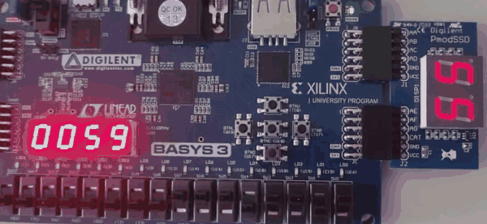
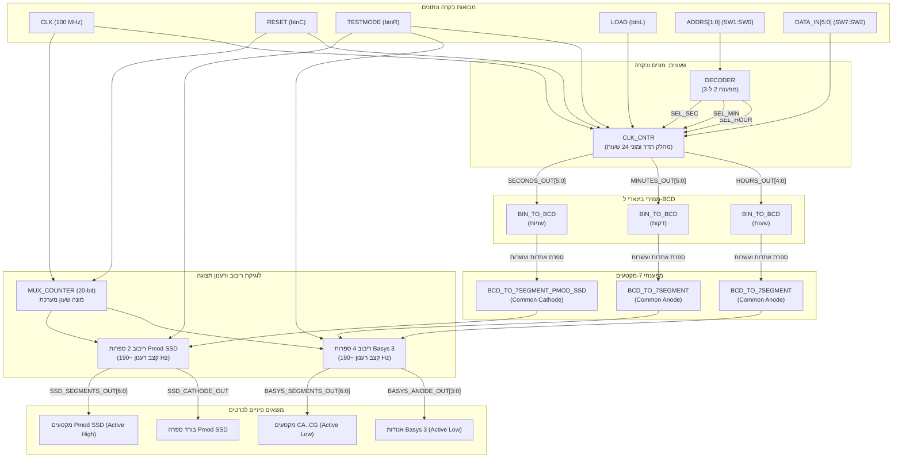
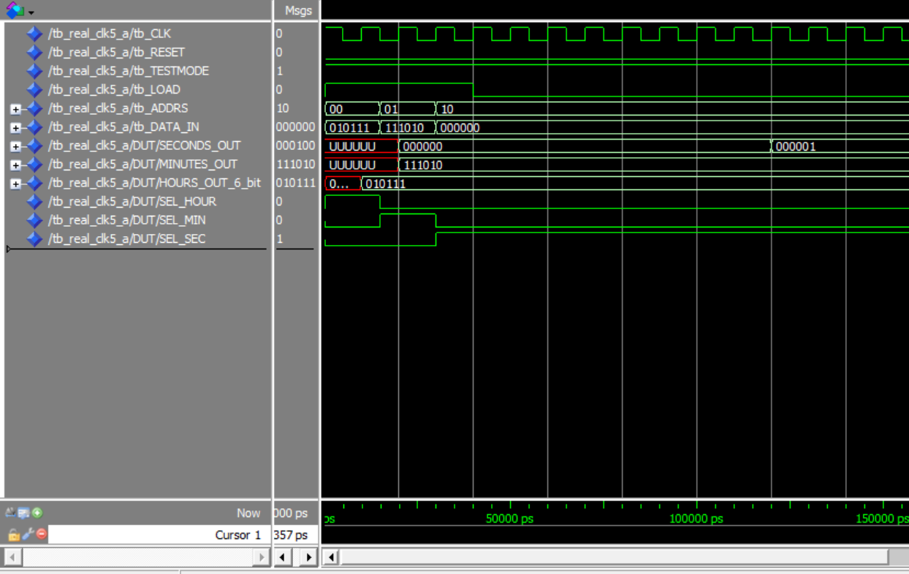
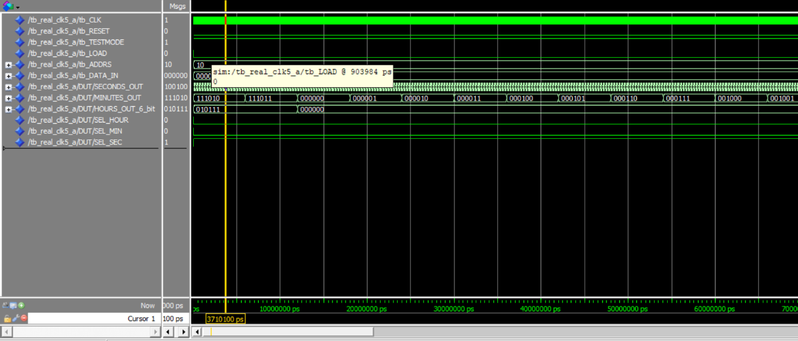
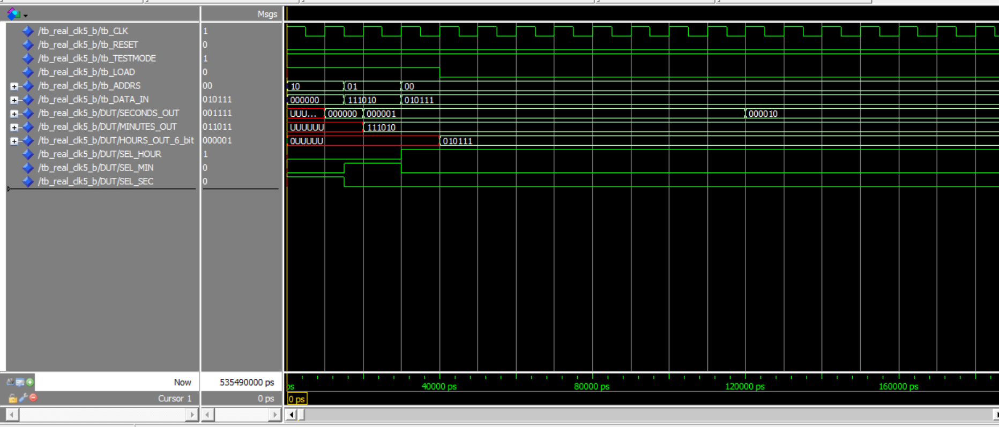
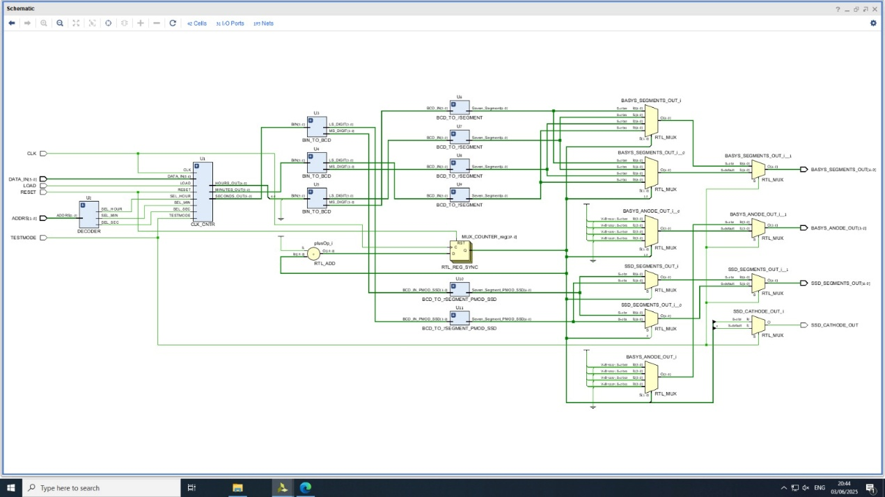
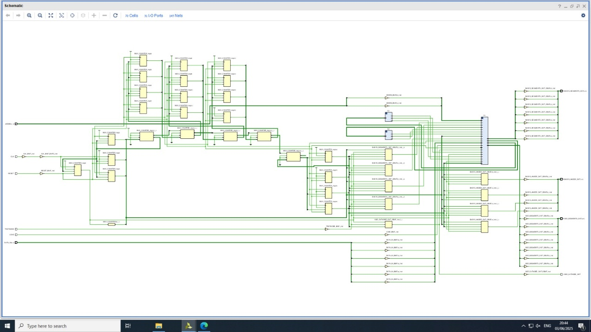

# שעון זמן אמת בן 24 שעות על גבי FPGA Basys 3 (בשפת VHDL)

> Language / שפה: [English](README.md) • [עברית (Hebrew)](README.he.md)

[](src/)
[](constrs/basys3_master.xdc)
[](https://digilent.com/reference/programmable-logic/basys-3/start)
[](scripts/build_vivado.tcl)
[](tb/)
[](LICENSE)

<p align="center">
  
  <br>
  <em><b>מערכת השעון בפעולה על גבי החומרה:</b> 4 ספרות ה-7-Segment שעל כרטיס ה-Basys 3 מציגות שעות ודקות (<b>14:15</b>), ורכיב ההרחבה Pmod SSD מציג שניות (<b>25</b>). נורית ה-DONE דולקת ומעידה על צריבה תקינה של ה-FPGA.</em>
</p>

---

## 📋 תוכן עניינים
1. [סקירת הפרויקט](#-סקירת-הפרויקט)
2. [רכיבי החומרה והציוד ההיקפי](#-רכיבי-החומרה-והציוד-ההיקפי)
3. [הוראות הרצה מהירה ושכפול](#-הוראות-הרצה-מהירה-ושכפול)
4. [מבנה תיקיות הפרויקט](#-מבנה-תיקיות-הפרויקט)
5. [ארכיטקטורת המערכת ופירוט מודולים](#-ארכיטקטורת-המערכת-ופירוט-מודולים)
6. [טבלת מיפוי פינים ואילוצים (Constraints)](#-טבלת-מיפוי-פינים-ואילוצים-constraints)
7. [סימולציה ואימות (ModelSim)](#-סימולציה-ואימות-modelsim)
8. [תוצאות סינתזה ומימוש (Vivado)](#-תוצאות-סינתזה-ומימוש-vivado)
9. [הדגמה חיה על גבי החומרה](#-הדגמה-חיה-על-גבי-החומרה)

---

## 🎯 סקירת הפרויקט

פרויקט זה מציג מימוש הנדסי מלא, מודולרי וסינתטי של **שעון זמן אמת דיגיטלי (RTC - Real Time Clock) בן 24 שעות**, שנכתב בשפת **VHDL-93** ונצרב בהצלחה על גבי כרטיס הפיתוח **Digilent Basys 3** המבוסס על שבב ה-FPGA **Xilinx Artix-7 (XC7A35T-1CPG236C)**, בשילוב רכיב תצוגה חיצוני **Digilent Pmod SSD**.

### תכונות עיקריות:
- **ספירת 24 שעות מלאה:** מונים סינכרוניים מדורגים עבור שניות (`00-59`), דקות (`00-59`), ושעות (`00-23`) עם התאפסות אוטומטית בחצות (`23:59:59` $\rightarrow$ `00:00:00`).
- **מחלק תדר מדויק (Time Base Prescaler):** מונה 27 ביט הממיר את שעון המערכת (100MHz) לפולס מדויק בקצב של 1Hz ($10^8$ מחזורי שעון).
- **תמיכה במצב בדיקה מואץ (`TESTMODE`):**
  - **מצב רגיל (`TESTMODE = 0`):** עבודה בקצב שעון קיר אמיתי (1Hz) ורענון תצוגות בקצב של כ-190Hz למניעת הבהוב (Flickering).
  - **מצב סימולציה/בדיקה (`TESTMODE = 1`):** האצת חלוקת התדר (חלוקה ב-10 במקום ב-$10^8$) והאצת ריבוב התצוגה, המאפשרים אימות גלים ב-ModelSim ללא צורך בהרצת מיליוני מחזורי שעון.
- **מנגנון טעינה מקבילית יזומה (Synchronous Parallel Load):**
  - מפענח כתובות 2 ביט (`ADDRS`) לבחירת הרגיסטר המיועד (`00`=שעות, `01`=דקות, `10`=שניות).
  - אפיק נתונים של 6 ביט (`DATA_IN[5:0]`) הנשלט באמצעות מפסקי הבורד.
  - כפתור דגימה סינכרוני (`LOAD`) לטעינת הערך בדיוק במוצא הרצוי.
- **ריבוב תצוגות הטרוגניות (Heterogeneous Display Multiplexing):**
  - 4 ספרות שעל גבי כרטיס ה-Basys 3 בחיבור **Common Anode** (הדלקה ב-Active-Low) מציגות שעות ודקות (**HH:MM**).
  - 2 ספרות של רכיב ה-Pmod SSD בחיבור **Common Cathode** (הדלקה ב-Active-High) מציגות שניות (**SS**).

---

## 🛠 רכיבי החומרה והציוד ההיקפי

| רכיב | תפקיד במערכת | מאפיינים וממשק |
| :--- | :--- | :--- |
| **Digilent Basys 3** | כרטיס פיתוח ראשי | רכיב Xilinx Artix-7 `XC7A35T-1CPG236C` |
| **מתנד פנימי 100MHz** | מקור השעון הראשי (`CLK`) | פין `W5` (זמן מחזור 10.0ns) |
| **תצוגת 7-מקטעים פנימית** | הצגת שעות ודקות (`HH:MM`) | 4 ספרות, אנודה משותפת (Common Anode, Active-Low) |
| **Digilent Pmod SSD** | הצגת שניות (`SS`) | 2 ספרות, קתודה משותפת (Common Cathode, Active-High), מחובר ל-JA/JB |
| **מפסקים SW0 - SW1** | בחירת כתובת רגיסטר (`ADDRS[1:0]`) | פינים `V17`, `V16` |
| **מפסקים SW2 - SW7** | ערך 6 ביט לטעינה (`DATA_IN[5:0]`) | פינים `W16`, `W17`, `W15`, `V15`, `W14`, `W13` |
| **כפתור מרכזי (btnC)** | איפוס סינכרוני למערכת (`RESET`) | פין `U18` |
| **כפתור שמאלי (btnL)** | פולס טעינה יזומה (`LOAD`) | פין `W19` |
| **כפתור ימני (btnR)** | מעבר למצב בדיקה מואץ (`TESTMODE`) | פין `T17` |

---

## 🚀 הוראות הרצה מהירה ושכפול

### 1. הרצת סימולציה ב-ModelSim / QuestaSim
ניתן לפתוח את ModelSim מתוך תיקיית `tb/` ולהריץ:
```shell
cd basys3-real-time-clock/tb
vsim -do sim_exp1.do
```
או להפעיל ישירות ב-Windows באמצעות הסקריפט:
```cmd
scripts\run_modelsim.bat
```

### 2. סינתזה ויצירת Bitstream ב-Vivado
ניתן להריץ בנייה מלאה באצווה בעזרת סקריפט ה-TCL:
```shell
cd basys3-real-time-clock/scripts
vivado -mode batch -source build_vivado.tcl
```
קובץ ה-Bitstream יווצר בנתיב: `scripts/build_output/REAL_CLK5.bit`.

---

## 📁 מבנה תיקיות הפרויקט

```text
basys3-real-time-clock/
├── LICENSE                   # קובץ רישיון קוד פתוח
├── README.md                 # תיעוד הפרויקט באנגלית (English)
├── README.he.md               # תיעוד הפרויקט בעברית (עברית)
├── .gitattributes             # הגדרות ניהול שורות וסוגי קבצים ב-Git
├── .gitignore                # סינון קבצים זמניים של Vivado ו-ModelSim
│
├── constrs/                  # אילוצי השמה ותזמון
│   └── basys3_master.xdc     # קובץ XDC מעודכן עם מיפוי פינים והערות מלאות
│
├── docs/                     # מסמכי הפרויקט, דוחות ומדריכים
│   ├── Ex05-Real_Clock-Part3.pdf        # חוברת מעבדה 5 חלק 3
│   ├── Ex05-Real_Clock-Part3-BOARD.pdf  # הנחיות עבודה על הכרטיס
│   ├── final_report.pdf                 # דוח מסכם סופי
│   ├── prep_report.pdf                  # עבודת הכנה
│   ├── board_video_link.md              # קישור ופירוט סרטון ההדגמה
│   └── assets/                          # תמונות, גלים וסכמות ברזולוציה גבוהה
│
├── reports/                  # דוחות סינתזה ומימוש מקוריים מ-Vivado
│   ├── REAL_CLK5_io_placed.rpt
│   ├── REAL_CLK5_timing_summary_routed.rpt
│   └── REAL_CLK5_utilization_placed.rpt
│
├── scripts/                  # סקריפטי אוטומציה להרצה
│   ├── build_vivado.tcl      # סקריפט בנייה אוטומטי ב-Vivado
│   └── run_modelsim.bat      # סקריפט הרצה מהיר ל-ModelSim
│
├── src/                      # קבצי מקור VHDL
│   ├── BCD_TO_7SEGMENT.vhd           # מפענח לספרות הבורד (Active Low)
│   ├── BCD_TO_7SEGMENT_PMOD_SSD.vhd  # מפענח ל-Pmod SSD (Active High)
│   ├── BIN_TO_BCD.vhd                # ממיר בינארי ל-BCD
│   ├── CLK_CNTR.vhd                  # מחלק תדר ומוני 24 שעות
│   ├── DECODER.vhd                   # מפענח כתובות 2 ל-3
│   └── REAL_CLK5.vhd                 # רכיב ראשי (Top Level)
│
└── tb/                       # קבצי בדיקה והדמיה
    ├── TB_REAL_CLK5_A.vhd    # טסטבנץ' ניסוי 1 (שעות -> דקות -> שניות)
    ├── TB_REAL_CLK5_B.vhd    # טסטבנץ' ניסוי 2 (שניות -> דקות -> שעות)
    ├── do.do                 # סקריפט קומפילציה בסיסי
    ├── sim_exp1.do           # סקריפט הדמיה מלא לניסוי 1
    └── sim_exp2.do           # סקריפט הדמיה מלא לניסוי 2
```

---

## 🏗 ארכיטקטורת המערכת ופירוט מודולים

המערכת בנויה באופן היררכי ומודולרי. רכיב ה-Top Level (`REAL_CLK5`) מחבר בין מודול המונים הראשי, מפענח הכתובות, ממירי הבינארי ל-BCD, מפענחי ה-7-Segment ורכיבי הריבוב בזמן (TDM).



### פירוט מודולי VHDL:
1. **[`REAL_CLK5.vhd`](src/REAL_CLK5.vhd) (מודול ראשי - Top Level):**
   - מבצע שיוך רכיבים (Port Mapping) מבני ומחבר את כל תתי-המערכות.
   - מכיל את מונה הריבוב `MUX_COUNTER` (20 ביט).
   - מיישם ריבוב של 4 ספרות הבורד ו-2 ספרות ה-Pmod SSD.
2. **[`CLK_CNTR.vhd`](src/CLK_CNTR.vhd) (מחלק תדר ומוני שעון):**
   - מחלק תדר מונה 27 ביט המייצר פולס 1Hz (`TC_TIMEBASE`).
   - מונה שניות (0-59), מונה דקות (0-59) ומונה שעות (0-23).
   - תומך בטעינה מקבילית סינכרונית בעת לחיצה על `LOAD`.
3. **[`DECODER.vhd`](src/DECODER.vhd) (מפענח כתובות רגיסטר):**
   - מפענח `ADDRS`: `"00"`=שעות, `"01"`=דקות, `"10"`=שניות.
4. **[`BIN_TO_BCD.vhd`](src/BIN_TO_BCD.vhd) (ממיר בינארי ל-BCD):**
   - ממיר ערך 6 ביט לשתי ספרות BCD (עשרות ואחדות).
5. **[`BCD_TO_7SEGMENT.vhd`](src/BCD_TO_7SEGMENT.vhd) (מפענח לספרות הבורד):**
   - דפוסי Active-Low עבור תצוגת Basys 3.
6. **[`BCD_TO_7SEGMENT_PMOD_SSD.vhd`](src/BCD_TO_7SEGMENT_PMOD_SSD.vhd) (מפענח ל-Pmod SSD):**
   - דפוסי Active-High עבור תצוגת Pmod SSD.

---

## 📌 טבלת מיפוי פינים ואילוצים (Constraints)

מוגדר בקובץ [`constrs/basys3_master.xdc`](constrs/basys3_master.xdc):

| שם הפורט | כיוון | פין בכרטיס | תקן I/O | תיאור פונקציונלי |
| :--- | :---: | :---: | :---: | :--- |
| `CLK` | מבוא | `W5` | LVCMOS33 | מתנד שעון ראשי 100MHz |
| `RESET` | מבוא | `U18` | LVCMOS33 | כפתור מרכזי (`btnC`) - איפוס מערכת סינכרוני |
| `TESTMODE` | מבוא | `T17` | LVCMOS33 | כפתור ימני (`btnR`) - מעבר למצב בדיקה מואץ |
| `LOAD` | מבוא | `W19` | LVCMOS33 | כפתור שמאלי (`btnL`) - פולס טעינה יזומה |
| `ADDRS[0]` | מבוא | `V17` | LVCMOS33 | מפסק SW0 - ביט כתובת 0 |
| `ADDRS[1]` | מבוא | `V16` | LVCMOS33 | מפסק SW1 - ביט כתובת 1 |
| `DATA_IN[0]` | מבוא | `W16` | LVCMOS33 | מפסק SW2 - ביט נתונים 0 |
| `DATA_IN[1]` | מבוא | `W17` | LVCMOS33 | מפסק SW3 - ביט נתונים 1 |
| `DATA_IN[2]` | מבוא | `W15` | LVCMOS33 | מפסק SW4 - ביט נתונים 2 |
| `DATA_IN[3]` | מבוא | `V15` | LVCMOS33 | מפסק SW5 - ביט נתונים 3 |
| `DATA_IN[4]` | מבוא | `W14` | LVCMOS33 | מפסק SW6 - ביט נתונים 4 |
| `DATA_IN[5]` | מבוא | `W13` | LVCMOS33 | מפסק SW7 - ביט נתונים 5 |
| `BASYS_ANODE_OUT[3:0]` | מוצא | `W4`, `V4`, `U4`, `U2` | LVCMOS33 | אנודות 4 הספרות של Basys 3 (Active Low) |
| `BASYS_SEGMENTS_OUT[6:0]` | מוצא | `W7` עד `U7` | LVCMOS33 | מקטעי CA..CG של Basys 3 (Active Low) |
| `SSD_CATHODE_OUT` | מוצא | `P18` | LVCMOS33 | בורר ספרה עבור Pmod SSD |
| `SSD_SEGMENTS_OUT[6:0]` | מוצא | `A14` עד `N17` | LVCMOS33 | מקטעי תצוגת Pmod SSD (Active High) |

---

## 🔬 סימולציה ואימות (ModelSim)

נבחנו שני תרחישי בדיקה מרכזיים ב-ModelSim כדי לחקור את התנהגות המערכת בסדרי טעינה שונים:

### ניסוי 1: טעינה בסדר שעות $\rightarrow$ דקות $\rightarrow$ שניות (`TB_REAL_CLK5_A`)
- **ערך מבוקש לטעינה:** `23:58:00`
- **סדר הפעולות:**
  1. קביעת `ADDRS = "00"` (שעות), ערך `23` (`"010111"`), לחיצה על `LOAD = '1'`.
  2. קביעת `ADDRS = "01"` (דקות), ערך `58` (`"111010"`), לחיצה על `LOAD = '1'`.
  3. קביעת `ADDRS = "10"` (שניות), ערך `00` (`"000000"`), לחיצה על `LOAD = '1'`.
  4. שחרור כפתור הטעינה `LOAD = '0'`.
- **מסקנה:** המונים מקבלים את הערכים בצורה תקינה ומתחילים לספור בצורה רציפה ומדויקת מ-`23:58:00`.


*תרשים: גל ModelSim המציג טעינה סינכרונית תקינה של שעות, דקות ושניות.*


*תרשים: המשך ספירה רציפה לאחר סיום תהליך הטעינה.*

---

### ניסוי 2: טעינה בסדר שניות $\rightarrow$ דקות $\rightarrow$ שעות (`TB_REAL_CLK5_B`)
- **ערך מבוקש לטעינה:** `23:58:00`
- **סדר הפעולות:** שניות נטענות ראשונות (`00`), לאחר מכן דקות (`58`), ולבסוף שעות (`23`).
- **ניתוח הנדסי ותופעת "בריחת השניות":**
  כאשר השניות נטענות ראשונות, מונה השניות אינו ממתין ומתחיל לרוץ מיד עם סיום הטעינה שלו. בזמן שהמשתמש עסוק בטעינת הדקות והשעות – השניות מספיקות "לברוח" ולהתקדם הלאה. ניסוי זה ממחיש את החשיבות ההנדסית של טעינת השניות אחרונות או הוספת מנגנון השהיה (Hold/Enable) בעת כיוון רב-רגיסטרי.


*תרשים: הדגמת התקדמות מונה השניות עוד בזמן טעינת הרגיסטרים הבאים.*

---

## 📊 תוצאות סינתזה ומימוש (Vivado)

התכנון סונתז ומומש במלואו עבור שבב **Artix-7 XC7A35T** בסביבת **Xilinx Vivado 2020.1**.

### ניצולת חומרה (`REAL_CLK5_utilization_placed.rpt`)
| משאב חומרה | כמות בשימוש | כמות זמינה בשבב | אחוז ניצולת |
| :--- | :---: | :---: | :---: |
| **Slice LUTs** | 142 | 20,800 | **0.68%** |
| **Slice Registers (FF)** | 65 | 41,600 | **0.16%** |
| **Bonded IOB** | 29 | 106 | **27.36%** |
| **F7 / F8 Muxes** | 0 | 16,300 | **0.00%** |
| **DSPs / Block RAM** | 0 | - | **0.00%** |

### עמידה באילוצי תזמון (`REAL_CLK5_timing_summary_routed.rpt`)
- **שם השעון:** `CLK`
- **תדר מטרה:** 100.000 MHz (זמן מחזור: 10.000 ns)
- **סטטוס:** כל רשתות השעון נותבו באופן מיטבי ברחבי ה-Clock Tree של השבב.


*תרשים: סכמת RTL Elaboration מתוך Vivado.*


*תרשים: השמת הרכיבים והניתוב הפיזי על גבי פיסות הסיליקון של ה-Artix-7.*

---

## 🎥 הדגמה חיה על גבי החומרה

המערכת נצרבה ואומתה בהצלחה על גבי כרטיס ה-FPGA:

<p align="center">
  
  <br>
  <em><b>השעון בפעולה:</b> ספירה סינכרונית של שעות, דקות ושניות על גבי תצוגת ה-Basys 3 הפנימית וה-Pmod SSD החיצוני. נורית ה-DONE דולקת ומעידה על פעולת FPGA תקינה.</em>
</p>

### דגשים עיקריים באימות החומרה:
1. **חלוקת תצוגה:** שעות ודקות מרובבות על גבי 4 ספרות ה-Basys 3 (אנודה משותפת), שניות מרובבות על גבי ה-Pmod SSD (קתודה משותפת).
2. **צריבת רכיב:** קובץ ה-Bitstream נצרב דרך Vivado Hardware Manager בעזרת כבל USB-JTAG.
3. **שליטה ובקרה:** כיוון והזנת זמנים התבצעו בעזרת המפסקים והכפתורים בהתאם לתכן.
