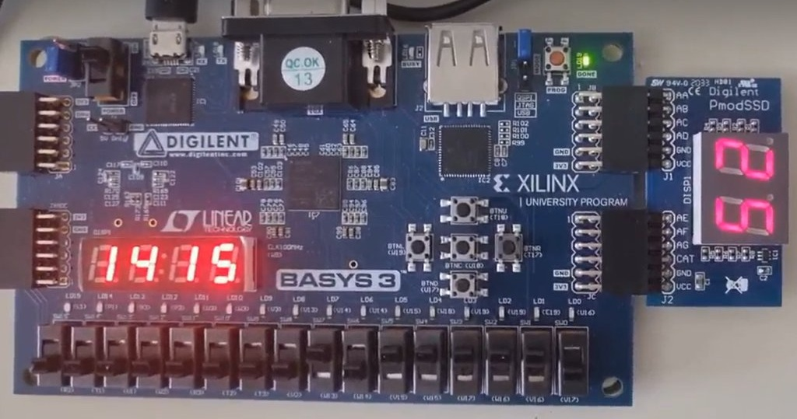
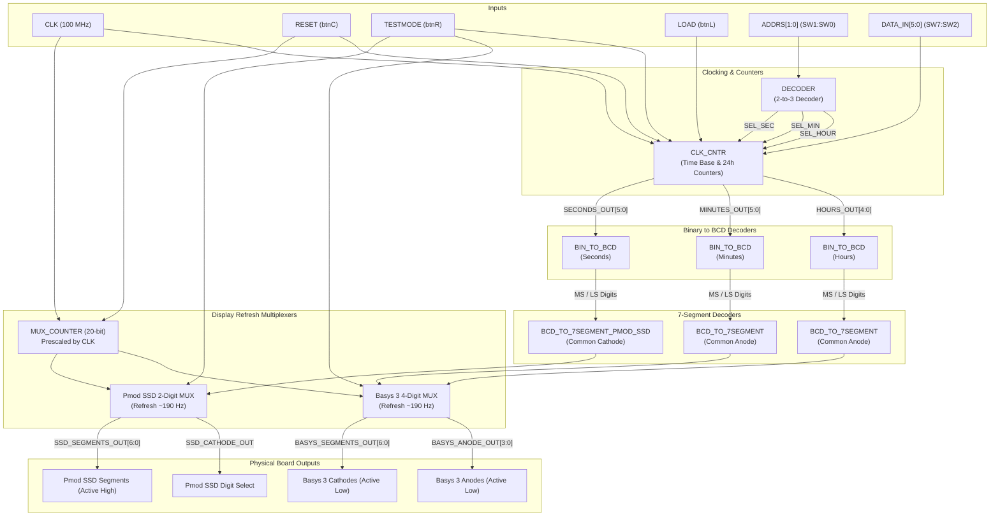
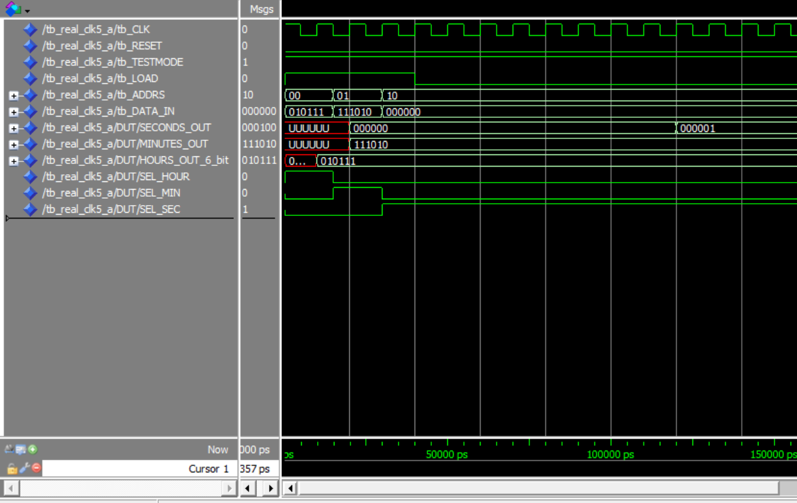
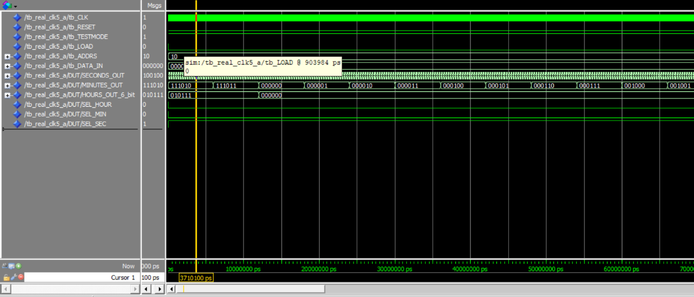
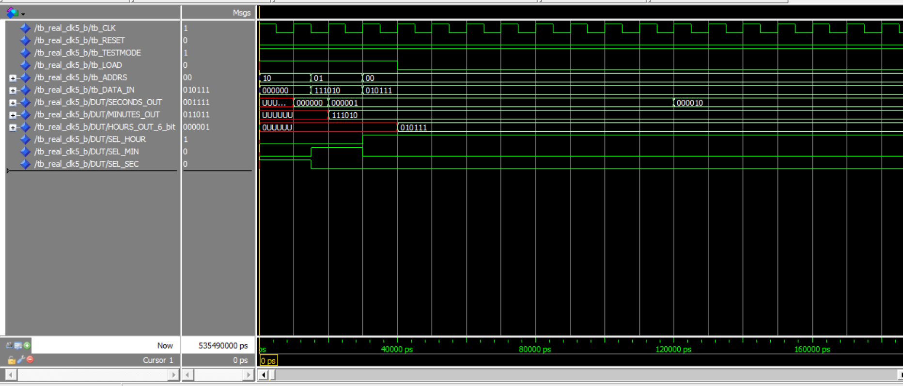
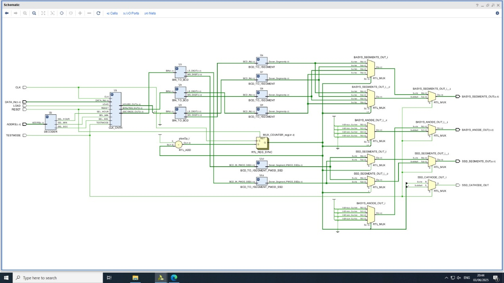
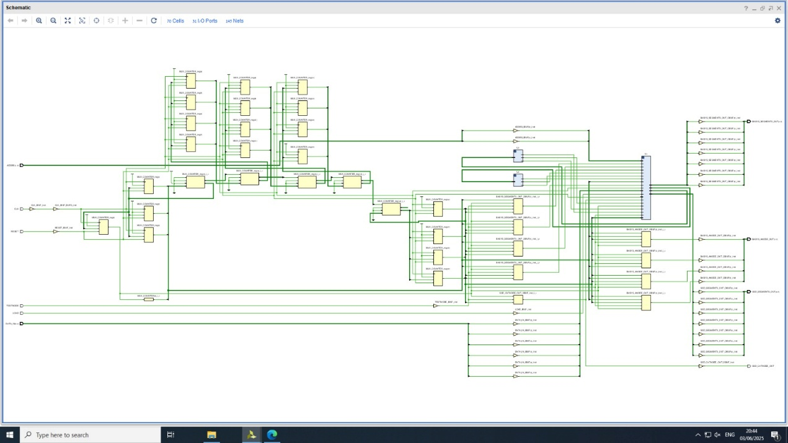

# 24-Hour Real-Time Digital Clock on Basys 3 FPGA (VHDL)

<p align="center">
  <a href="README.md"><b>English 🇬🇧</b></a> | 
  <a href="README.he.md"><b>עברית 🇮🇱</b></a>
</p>

[](src/)
[](constrs/basys3_master.xdc)
[](https://digilent.com/reference/programmable-logic/basys-3/start)
[](scripts/build_vivado.tcl)
[](tb/)

<p align="center">
  
  <br>
  <em><b>Real-Time Clock physically running on hardware:</b> Digilent Basys 3 onboard 7-segment display shows Hours and Minutes (<b>14:15</b>), while the Digilent Pmod SSD displays Seconds (<b>25</b>).</em>
</p>

---

## 📋 Table of Contents
1. [Project Overview](#-project-overview)
2. [Hardware & Peripheral Setup](#-hardware--peripheral-setup)
3. [System Architecture](#-system-architecture)
4. [Submodules Description](#-submodules-description)
5. [Pinout & FPGA Constraints](#-pinout--fpga-constraints)
6. [Simulation & Verification](#-simulation--verification)
7. [Synthesis & Implementation Results](#-synthesis--implementation-results)
8. [Hardware Demonstration Video](#-hardware-demonstration-video)
9. [How to Run & Reproduce](#-how-to-run--reproduce)
10. [תקציר הפרויקט בעברית](#-תקציר-הפרויקט-בעברית)

---

## 🎯 Project Overview

This repository features a complete, synthesizable **24-Hour Digital Real-Time Clock (RTC)** designed in **VHDL** and implemented on the **Digilent Basys 3 FPGA** development board (Xilinx Artix-7 `XC7A35T-1CPG236C`), augmented with a **Digilent Pmod SSD** dual 7-segment display.

The system features:
- **Full 24-Hour Range:** Counts Seconds (`00-59`), Minutes (`00-59`), and Hours (`00-23`) with automatic rollovers.
- **Accurate Time Base Prescaler:** Derives a precise 1 Hz tick from the onboard 100 MHz crystal oscillator ($10^8$ clock cycles).
- **Dual-Mode Operation (`TESTMODE`):**
  - **Normal Mode (`TESTMODE = 0`):** Standard 1 Hz wall-clock operation with a 190 Hz human-readable display refresh rate.
  - **Test/Simulation Mode (`TESTMODE = 1`):** Accelerates clock division ($10$ clock cycles) and display multiplexing, enabling full end-to-end waveform simulation in ModelSim without requiring millions of clock cycles.
- **Synchronous Register Load Mechanism:** Allows arbitrary initial time programming using a 2-bit address decoder (`ADDRS`), a 6-bit data bus (`DATA_IN`), and a load strobe button (`LOAD`).
- **Heterogeneous Dual-Display Multiplexing:**
  - 4 onboard common-anode 7-segment digits display **HH:MM**.
  - 2 external Pmod SSD common-cathode 7-segment digits display **SS**.

---

## 🛠 Hardware & Peripheral Setup

| Component | Function | Interface / Spec |
| :--- | :--- | :--- |
| **Digilent Basys 3** | Primary FPGA Development Platform | Xilinx Artix-7 `XC7A35T-1CPG236C` |
| **Onboard 100 MHz Oscillator** | Master clock source (`CLK`) | Pin `W5` (10.0 ns period) |
| **Onboard 7-Segment Display** | Displays Hours and Minutes (`HH:MM`) | 4 Digits, Common Anode, Active-Low |
| **Digilent Pmod SSD** | Displays Seconds (`SS`) | 2 Digits, Common Cathode, Active-High, Header JA/JB |
| **Slide Switches (SW0 - SW1)** | Target register address select (`ADDRS[1:0]`) | Pins `V17`, `V16` |
| **Slide Switches (SW2 - SW7)** | Target 6-bit load data value (`DATA_IN[5:0]`) | Pins `W16`, `W17`, `W15`, `V15`, `W14`, `W13` |
| **Push Button (btnC)** | Synchronous System Reset (`RESET`) | Pin `U18` |
| **Push Button (btnL)** | Synchronous Load Strobe (`LOAD`) | Pin `W19` |
| **Push Button (btnR)** | Test Mode Enable (`TESTMODE`) | Pin `T17` |

---

## 🏗 System Architecture

The design is strictly hierarchical and modular. The top-level entity `REAL_CLK5` orchestrates the timebase counter, address decoder, binary-to-BCD converters, 7-segment display drivers, and display multiplexing logic.



---

## 🧩 Submodules Description

All VHDL source files are located in the [`src/`](src/) directory:

1. **[`REAL_CLK5.vhd`](src/REAL_CLK5.vhd) (Top Level Entity):**
   - Connects all components via structural port mapping.
   - Contains `MUX_COUNTER`, a 20-bit free-running counter clocked at 100 MHz.
   - Implements 4-way time-division multiplexing for the onboard display (`MUX_COUNTER(19 downto 18)` in normal mode; `MUX_COUNTER(1 downto 0)` in test mode).
   - Implements 2-way time-division multiplexing for the Pmod SSD (`MUX_COUNTER(18)` in normal mode; `MUX_COUNTER(0)` in test mode).

2. **[`CLK_CNTR.vhd`](src/CLK_CNTR.vhd) (Time Base Prescaler & Cascade Counters):**
   - **Time Base Generator:** 27-bit prescaler `Q` dividing the 100 MHz clock down to 1 Hz (`TC_TIMEBASE`).
     - Normal Mode: Counts $0$ to $99,999,999$ (1 second tick).
     - Test Mode: Counts $0$ to $9$ (10 clock tick) for rapid simulation.
   - **Seconds Counter (`Q_SECONDS`):** Modulo-60 counter ($0$ to $59$).
   - **Minutes Counter (`Q_MINUTES`):** Increments when `TC_TIMEBASE = '1'` and `Q_SECONDS = 59`.
   - **Hours Counter (`Q_HOURS`):** Increments when `TC_TIMEBASE = '1'`, `Q_SECONDS = 59`, and `Q_MINUTES = 59`. Wraps at $23 \rightarrow 00$.
   - Supports individual synchronous parallel loading for each register when `LOAD = '1'` and its corresponding select line is asserted.

3. **[`DECODER.vhd`](src/DECODER.vhd) (Register Address Decoder):**
   - Decodes the 2-bit switch input `ADDRS`:
     - `"00"` $\rightarrow$ `SEL_HOUR = '1'`
     - `"01"` $\rightarrow$ `SEL_MIN  = '1'`
     - `"10"` $\rightarrow$ `SEL_SEC  = '1'`
     - `"11"` $\rightarrow$ All selects deasserted (idle).

4. **[`BIN_TO_BCD.vhd`](src/BIN_TO_BCD.vhd) (Binary to BCD Converter):**
   - Converts 6-bit binary integers ($0-59$) into two 4-bit Binary Coded Decimal digits (`MS_DIGIT` and `LS_DIGIT`).

5. **[`BCD_TO_7SEGMENT.vhd`](src/BCD_TO_7SEGMENT.vhd) (Onboard Display Decoder):**
   - Generates active-low segment patterns (`"0"` turns segment ON) for the common-anode Basys 3 7-segment display.

6. **[`BCD_TO_7SEGMENT_PMOD_SSD.vhd`](src/BCD_TO_7SEGMENT_PMOD_SSD.vhd) (Pmod SSD Decoder):**
   - Generates active-high segment patterns (`"1"` turns segment ON) for the common-cathode Digilent Pmod SSD.

---

## 📌 Pinout & FPGA Constraints

Defined in [`constrs/basys3_master.xdc`](constrs/basys3_master.xdc):

| Port Name | Direction | Pin | I/O Standard | Description |
| :--- | :---: | :---: | :---: | :--- |
| `CLK` | Input | `W5` | LVCMOS33 | 100 MHz Onboard Master Oscillator |
| `RESET` | Input | `U18` | LVCMOS33 | Push Button Center (`btnC`) - Synchronous Reset |
| `TESTMODE` | Input | `T17` | LVCMOS33 | Push Button Right (`btnR`) - Test/Simulation Speed |
| `LOAD` | Input | `W19` | LVCMOS33 | Push Button Left (`btnL`) - Synchronous Load Strobe |
| `ADDRS[0]` | Input | `V17` | LVCMOS33 | Slide Switch SW0 - Address bit 0 |
| `ADDRS[1]` | Input | `V16` | LVCMOS33 | Slide Switch SW1 - Address bit 1 |
| `DATA_IN[0]` | Input | `W16` | LVCMOS33 | Slide Switch SW2 - Data bit 0 |
| `DATA_IN[1]` | Input | `W17` | LVCMOS33 | Slide Switch SW3 - Data bit 1 |
| `DATA_IN[2]` | Input | `W15` | LVCMOS33 | Slide Switch SW4 - Data bit 2 |
| `DATA_IN[3]` | Input | `V15` | LVCMOS33 | Slide Switch SW5 - Data bit 3 |
| `DATA_IN[4]` | Input | `W14` | LVCMOS33 | Slide Switch SW6 - Data bit 4 |
| `DATA_IN[5]` | Input | `W13` | LVCMOS33 | Slide Switch SW7 - Data bit 5 |
| `BASYS_ANODE_OUT[3:0]` | Output | `W4`, `V4`, `U4`, `U2` | LVCMOS33 | Anodes for Basys 3 Digits (Active Low) |
| `BASYS_SEGMENTS_OUT[6:0]` | Output | `W7` - `U7` | LVCMOS33 | Cathodes for Basys 3 Segments CA..CG (Active Low) |
| `SSD_CATHODE_OUT` | Output | `P18` | LVCMOS33 | Digit Select for Pmod SSD |
| `SSD_SEGMENTS_OUT[6:0]` | Output | `A14` - `N17` | LVCMOS33 | Segments for Pmod SSD (Active High) |

---

## 🔬 Simulation & Verification

Two verification scenarios were simulated using ModelSim to analyze system behavior under different load sequences.

### Experiment 1: Hours $\rightarrow$ Minutes $\rightarrow$ Seconds Loading (`TB_REAL_CLK5_A`)
- **Target Time Loaded:** `23:58:00`
- **Sequence:**
  1. Set `ADDRS = "00"` (Hours), `DATA_IN = 23` (`"010111"`), `LOAD = '1'`.
  2. Set `ADDRS = "01"` (Minutes), `DATA_IN = 58` (`"111010"`), `LOAD = '1'`.
  3. Set `ADDRS = "10"` (Seconds), `DATA_IN = 00` (`"000000"`), `LOAD = '1'`.
  4. Deassert `LOAD = '0'`.
- **Result:** The counters capture the loaded values cleanly, and continuous incrementing proceeds accurately from `23:58:00`.


*Figure: ModelSim waveform showing synchronous load of Hours, Minutes, and Seconds.*


*Figure: Counters advancing after load completion.*

---

### Experiment 2: Seconds $\rightarrow$ Minutes $\rightarrow$ Hours Loading (`TB_REAL_CLK5_B`)
- **Target Time Loaded:** `23:58:00`
- **Sequence:** Seconds loaded first (`00`), then Minutes (`58`), then Hours (`23`).
- **Engineering Analysis & Race Condition Observation:**
  When Seconds are loaded first, the seconds counter begins incrementing immediately while the user is still configuring and loading the minutes and hours registers. As a consequence, seconds "escape" (advance) ahead of the intended time before the full clock configuration is completed. This illustrates the engineering importance of loading seconds last or implementing a global freeze/enable during multi-register programming.


*Figure: Seconds loaded first, illustrating counter advancement during subsequent register loads.*

---

## 📊 Synthesis & Implementation Results

The design was fully synthesized and implemented for the **Artix-7 XC7A35T** using **Xilinx Vivado 2020.1**.

### Resource Utilization (`REAL_CLK5_utilization_placed.rpt`)
| Resource | Used | Available | Utilization % |
| :--- | :---: | :---: | :---: |
| **Slice LUTs** | 142 | 20,800 | **0.68%** |
| **Slice Registers (FF)** | 65 | 41,600 | **0.16%** |
| **Bonded IOB** | 29 | 106 | **27.36%** |
| **F7 / F8 Muxes** | 0 | 16,300 | **0.00%** |
| **DSPs / Block RAM** | 0 | - | **0.00%** |

### Timing & Clock Summary (`REAL_CLK5_timing_summary_routed.rpt`)
- **Clock Name:** `CLK`
- **Target Frequency:** 100.000 MHz
- **Period:** 10.000 ns (50% Duty Cycle: High 5.0 ns, Low 5.0 ns)
- **Status:** All synchronous clock nets routed cleanly across the clock tree.


*Figure: RTL Elaborated schematic generated by Vivado.*


*Figure: Physical placement on the Artix-7 die.*

---

## 🎥 Hardware Demonstration & Physical Execution

The system was deployed, programmed, and experimentally verified on actual hardware:

<p align="center">
  
  <br>
  <em><b>Live Execution:</b> Clock display showing <code>14:15:25</code> (Basys 3 onboard digits: <code>14:15</code>, Pmod SSD: <code>25</code>). Note the illuminated green <code>DONE</code> LED indicating successful FPGA bitstream programming.</em>
</p>

### Key Hardware Verification Highlights
1. **Clock Display Breakdown:**
   - **Hours & Minutes:** `14:15` rendered via active-low common-anode time-division multiplexing on the 4-digit onboard display.
   - **Seconds:** `25` rendered via active-high common-cathode time-division multiplexing on the Digilent Pmod SSD.
2. **FPGA Configuration:**
   - Bitstream programmed over USB-JTAG using Vivado Hardware Manager.
   - Status confirmed by the green `DONE` LED (LD19).
3. **Interactive Control:**
   - Inputs read from slide switches SW0-SW7 and push buttons `LOAD`, `RESET`, `TESTMODE`.
4. **Demonstration Video:**
   - 🔗 **Full Video Link:** [Basys 3 Real-Time Clock Hardware Demo (SharePoint)](https://gjctacil-my.sharepoint.com/:v:/g/personal/orlev_g_jct_ac_il/EeOraA01wDtKiLFiv6LwWPYBSL3SGPeE2fRB4Dj4Snh_vQ?e=jtXFVR)
   - Demonstrates minute rollovers (e.g. `09:35:54` $\rightarrow$ `09:36:00`), midnight rollover (`23:59:54` $\rightarrow$ `00:00:00`), and real-time vs. test-mode clock scaling.

---

## 🚀 How to Run & Reproduce

### 1. Simulation via ModelSim / QuestaSim
Open ModelSim in the `tb/` directory or run the included batch script:
```shell
cd basys3-real-time-clock/tb
vsim -do sim_exp1.do
```
Or execute the automated batch launcher:
```cmd
scripts\run_modelsim.bat
```

### 2. Vivado Synthesis & Bitstream Generation
Launch Vivado batch build using the provided TCL script:
```shell
cd basys3-real-time-clock/scripts
vivado -mode batch -source build_vivado.tcl
```
The output bitstream will be generated at `scripts/build_output/REAL_CLK5.bit`.

---

## 🇮🇱 תקציר הפרויקט בעברית

פרויקט זה מציג מימוש מלא, סינתטי ונבדק של **שעון זמן אמת (RTC - Real Time Clock) בן 24 שעות**, שנכתב בשפת **VHDL** ויושם בהצלחה על גבי כרטיס הפיתוח **Digilent Basys 3** המבוסס על רכיב ה-FPGA **Xilinx Artix-7 (XC7A35T)**, בשילוב תצוגת הרחבה **Pmod SSD**.

### עיקרי המערכת:
1. **ספירה שלמה של 24 שעות:** מונים נפרדים לשניות (0-59), דקות (0-59) ושעות (0-23) עם מעברים אוטומטיים והתאפסות בחצות (`23:59:59` $\rightarrow$ `00:00:00`).
2. **מחלק תדר (Time Base Prescaler):** המרה של תדר השעון הראשי (100MHz) לפולס בקצב 1Hz מדויק באמצעות מונה 27 ביט.
3. **מצב בדיקה מואץ (`TESTMODE`):**
   - במצב רגיל (`TESTMODE=0`): עבודה בקצב שעון קיר אמיתי (1Hz) ורענון תצוגה בקצב 190Hz.
   - במצב בדיקה (`TESTMODE=1`): חלוקת תדר מקוצרת (חלוקה ב-10) המאפשרת לדמות מחזורי ספירה שלמים ב-ModelSim במהירות גבוהה ללא צורך בהרצת מיליוני מחזורים.
4. **מנגנון טעינה סינכרוני:** טעינה יזומה של שעות, דקות ושניות בעזרת 2 מפסקי כתובת (`ADDRS`), 6 מפסקי נתונים (`DATA_IN`) וכפתור טעינה (`LOAD`).
5. **תצוגת 7-מקטעים מרובבת:** שעות ודקות מוצגות על 4 הספרות המובנות בבורד (Common Anode, Active Low), והשניות מוצגות על רכיב Pmod SSD החיצוני (Common Cathode, Active High).

---

## 📁 Repository Directory Structure

```text
basys3-real-time-clock/
├── .gitattributes             # Git file format & normalization settings
├── .gitignore                # Git ignore patterns for Vivado and ModelSim
├── README.md                 # Project documentation and engineering manual
│
├── constrs/                  # Physical Constraints
│   └── basys3_master.xdc     # XDC pinout and timing constraints for Basys 3 & Pmod
│
├── docs/                     # Documentation and Reports
│   ├── Ex05-Real_Clock-Part3.pdf        # Lab specifications (English)
│   ├── Ex05-Real_Clock-Part3-BOARD.pdf  # Board implementation guidelines
│   ├── final_report.pdf                 # Final lab report with experimental results
│   ├── prep_report.pdf                  # Preliminary design calculations report
│   ├── board_video_link.md              # SharePoint video demonstration link
│   └── assets/                          # Architecture schematics & simulation waveforms
│       ├── architecture_block_diagram.jpg
│       ├── sim_waveform_exp1_load.png
│       ├── sim_waveform_exp1_counting.png
│       ├── sim_waveform_exp1_overview.png
│       ├── sim_waveform_exp2_seconds_loaded.png
│       ├── sim_waveform_exp2_seconds_advancing.png
│       ├── vivado_rtl_schematic.jpg
│       ├── vivado_device_placed.jpg
│       ├── vivado_timing_summary.jpg
│       └── vivado_utilization_chart.jpg
│
├── reports/                  # Vivado Implementation Reports
│   ├── REAL_CLK5_io_placed.rpt
│   ├── REAL_CLK5_timing_summary_routed.rpt
│   └── REAL_CLK5_utilization_placed.rpt
│
├── scripts/                  # Automation Scripts
│   ├── build_vivado.tcl      # Vivado non-project batch synthesis & bitstream generation
│   └── run_modelsim.bat      # ModelSim simulation launcher
│
├── src/                      # Synthesizable VHDL Source Code
│   ├── BCD_TO_7SEGMENT.vhd           # 7-Segment Decoder (Common Anode, Active-Low)
│   ├── BCD_TO_7SEGMENT_PMOD_SSD.vhd  # 7-Segment Decoder (Common Cathode, Active-High)
│   ├── BIN_TO_BCD.vhd                # 6-bit Binary to BCD Converter
│   ├── CLK_CNTR.vhd                  # Prescaler & 24h Synchronous Counters
│   ├── DECODER.vhd                   # 2-to-3 Register Address Decoder
│   └── REAL_CLK5.vhd                 # Top-Level Structural Entity
│
└── tb/                       # Simulation Testbenches & DO Scripts
    ├── TB_REAL_CLK5_A.vhd    # Experiment 1 Testbench (Hours -> Minutes -> Seconds)
    ├── TB_REAL_CLK5_B.vhd    # Experiment 2 Testbench (Seconds -> Minutes -> Hours)
    ├── do.do                 # Quick compilation macro
    ├── sim_exp1.do           # Experiment 1 ModelSim script with waveform setup
    └── sim_exp2.do           # Experiment 2 ModelSim script with waveform setup
```
